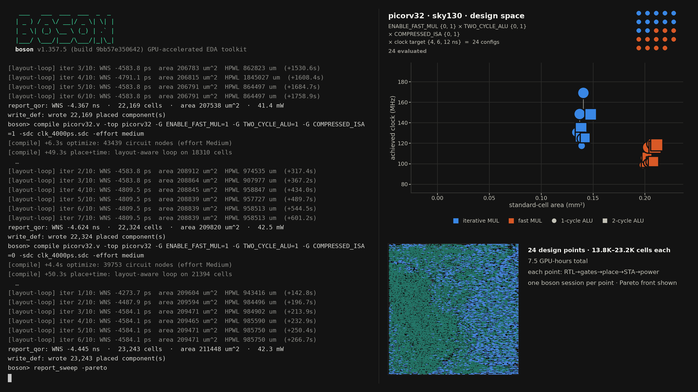
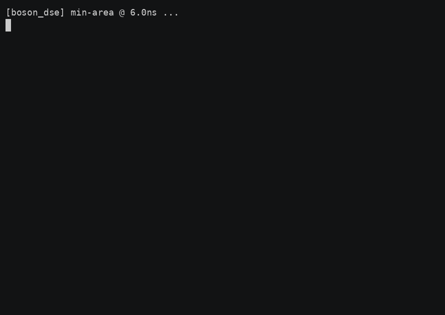

# boson-explore

A Claude Code plugin of design-space and power exploration skills for
[boson](https://partcl.com), partcl's GPU-accelerated EDA toolkit. Each
skill drives Claude through a real synthesis → STA → power sweep — every
number in the output table is from an actual boson run, not an estimate.

boson itself is partcl's product and is **not** included here; you need a
`boson` binary and a Liberty (`.lib`) file for your standard-cell library
to use these skills. The bundled example design needs neither a paid PDK
nor a testbench — see below.

## What's in here

Five skills. Each `SKILL.md` is a short router: what the skill is for, the
rules every mode shares, and a table that sends Claude to the one reference
file the task needs. The detailed workflow loads only when that mode is
chosen. (`boson-help` is the exception — small enough to be
self-contained.)

- **`skills/boson-explore`** — explore a block's area/power/timing design
  space with real boson runs.
  - *Tradeoff table* (`references/tradeoff-table.md`) — Sweep clock period and/or RTL
    parameters through boson, get back an area/power/timing tradeoff table.
    Auto-invoked by Claude when you ask things like "sweep this design and
    show me the power/timing tradeoff" or "which config is smallest".
  - *Sweep video* (`references/sweep-video.md`) — Run a parameter × clock-period sweep
    (one real compile+place+STA+power per point, DEF written) and render it
    as an animated GIF/MP4: a boson terminal replaying each point's compile,
    the parameter grid lighting up, a PPA scatter (area vs achieved clock,
    size = power) filling in, and the real placement of each point. Ends on
    the Pareto front. Triggers on "make a sweep video", "animate the PPA space".
- **`skills/boson-close-timing`** — close timing or find fmax without
  changing the RTL: constraints first, then the cheapest recipe.
  - *Effort ladder* (`references/ladder.md`) — Close timing at a target clock with the
    *cheapest* boson recipe that works: `compile -effort medium`, then
    `-retime`, then `-effort high`, each reported straight out of compile and again after an
    optional extra `repair_timing -setup`. Stops at the first rung meeting
    timing, plus an fmax search. Hands back the ladder table and the
    recommended compile Tcl; when nothing closes, it points at the critical
    path with `compile -provenance` / `report_provenance` rather than at more
    settings. Triggers on "close timing at X ns", "what's the fmax", "which
    effort should I use".
    Sample run (picorv32 on sky130 tt, boson 1.1071, `--target-ns 2.6 --no-power`):

    | effort | stage | period (ns) | timing | WNS (ns) | TNS (ns) | achieved (MHz) | cells | area (µm²) |
    |---|---|---|---|---|---|---|---|---|
    | medium | compile | 2.6 | VIOLATED | -0.103 | -2.321 | 370 | 13,327 | 120,030 |
    | medium | +repair_timing -setup | 2.6 | VIOLATED | -0.069 | -0.971 | 375 | 13,494 | 121,101 |
    | medium+retime | compile | 2.6 | MET | +0.000 | +0.000 | 385 | 12,403 | 123,461 |
    | medium+retime | +repair_timing -setup | 2.6 | MET | +0.000 | +0.000 | 385 | 12,384 | 123,302 |

    Verdict: plain medium misses 2.6 ns by 0.10 ns and the extra
    `repair_timing -setup` only narrows it; `-retime` closes it at the same
    effort for +3 % area, so the ladder stops there without paying for high.
    With `--find-fmax`, high effort reaches **fmax ≈ 370 MHz** on this core
    without retiming.
  - *Constraint and engine loop* (`references/constraint-engine-loop.md`) and
    *placement continuity* (`references/placement-continuity.md`) for suspect
    SDC, synthesis failures and QoR that moves after netlist edits.
- **`skills/boson-rtl-optimize`** — change the RTL with boson as the judge.
  - *Meet timing* (`references/meet-timing.md`) — When settings can't close timing
    and the RTL has to change: `timing_probe.py` turns a standard boson compile
    into critical paths that map back to source (launch/capture register
    names survive synthesis, plus RTL-named nets, logic depth, slowest cells,
    fanout), and the skill drives an edit → probe → edit loop with hard rules
    — non-RTL levers first, one edit per probe, restructure before pipeline,
    ask before any latency change, clean git tree, run the project's tests,
    confirm in the user's own flow. Sample probe (picorv32 @ 4 ns on sky130):

    ```
    period 4 ns · effort medium · WNS 0.004 ns (MET) · TNS 0.0 ns · 0/2409 endpoints violating · 11484 cells · 12s
    ### path 1: slack 0.004 ns (MET), 11 logic stages, arrival 3.904 ns
    - from `genblk2.pcpi_div.dividend_reg[0]`
    - to   `genblk2.pcpi_div.pcpi_rd_reg[29]`
    - slowest stages: sky130_fd_sc_hd__or4_1 0.487 ns, sky130_fd_sc_hd__or4_1 0.410 ns, sky130_fd_sc_hd__or4_1 0.401 ns
    ```
  - *Evolve* (`references/evolve.md`) — An evolutionary RTL-optimisation loop
    with boson as the evaluator. The objective is max Fmax
    (1/(T − WNS)), min area or min power, optionally with caps on the
    others, e.g. area ≤ +15 %. Each candidate is one hypothesis, committed,
    passed through an equivalence gate (lint, sound formal miter, lockstep
    co-simulation with directed corners), then scored by boson: compile →
    timing/area/power. The skill includes anti-gaming
    rules, a results ledger and a budget. It ends with a declared final
    that is rerun and signed off. Triggers on "optimise this RTL for Fmax",
    "run an RTL optimisation loop".
- **`skills/boson-diagnose`** — why a boson result is bad, and the evidence
  for partcl. Every method starts by instrumenting the user's own compile:
  `-provenance` (each cell traced to its RTL line, datapath block and the
  passes and repairs that touched it, read with `report_provenance`),
  `synth_graph_snapshot_dir` (the circuit after every datapath, logic and
  repair stage, browsable in `viewer.html`) and the decision journal, none of
  which changes the netlist; and an extra `repair_timing -setup` separates a
  structure problem from a repair problem.
  - *Journal debug* (`references/journal-debug.md`) — Run on your own machine against a boson
    run of your design: reads the netlist, timing / QoR / check_timing
    reports, SDC, log and boson's decision journal (`decision_log_file`), ties
    each failing path to the decisions that shaped it (adder architecture,
    sizing that flip-flopped, hold repair that ate setup, repairs that were
    rolled back, ignored constraints, unbuffered high-fanout nets), lists the
    netlist's current issues, and builds `boson-debug-bundle.tar.gz` for
    partcl. Every design name, path, user/host name and library name is
    replaced by a consistent token (`u3/r12_reg[4]`, `clk0`, `LIBX`); the
    decoding map stays with you, and a leak check must pass before the
    tarball is written. Nothing is uploaded. Triggers on "what did boson do
    wrong", "why is my netlist bad", "prepare a debug bundle for partcl".
  - *Datapath audit* (`references/datapath-audit.md`) — What boson actually built for the
    arithmetic on the critical paths: per adder/subtractor/comparator, the
    architecture the datapath selector chose (ripple, carry-select, Sklansky,
    Brent-Kung, Han-Carlson, ...), the mapped cells it puts on each path against
    that architecture's depth, and the share of its cells each logic rewrite
    (`dc2`, `dretime`, `prefix_scan`) restructured. Built on `compile
    -provenance`. Triggers on "did it use Han-Carlson or ripple", "did dc2 undo
    the adder".
  - *Minimal repro* (`references/minimal-repro.md`) — Debug a few paths that are far deeper
    than the clock allows: name the RTL construct on the path, compile it alone
    as a module-level boson run under the same clock, then A/B equivalent
    rewrites, widths and clocks of that construct. The result is a finding
    (coding-style sensitivity, architecture limit, or context) and a debug
    report that keeps RTL text and names in the user's environment. Includes
    `path_levels.py`, which counts logic levels per path, excluding buffers and
    inverters. Triggers on "is this the RTL or boson", "why is this path so
    deep", "the full run is too slow to debug".
  - *Reference compare* (`references/compare-reference.md`) — Explain why a boson netlist is
    worse than a reference netlist of the same RTL and library (another tool's
    result, or an earlier boson version's), in patterns partcl can fix. First
    checks the runs are comparable: boson version, a wire model recalibrated
    from the global route (PAR-252), app variables and the stage-by-stage QoR
    trajectory (`run_ab.py`). Then splits the std-cell area gap by mapping
    pattern with every cell classed by its Liberty function, not its name
    (`cell_mix.py`: full adders against split sum + carry cells, XOR/XNOR,
    muxes against complex gates, gates wired as XNOR by tied inputs, clock
    cells in data logic, VT mix), says what the XORs are for and compares the
    cone of one output (`logic_patterns.py`), compares buffer trees by distance
    and sink count with buffer spacing from the DEF (`buffer_trees.py`,
    `route_layers.py`), and groups failing paths into families with their
    buffer delay against the violation (`path_families.py`). Ends in ranked,
    evidence-backed findings, each with a concrete example and the next
    experiment. Triggers on "why is boson's area bigger than the other tool's",
    "why did the new version regress", "write up what we found for partcl".
  - *DC datapath compare* (`references/compare-dc.md`) — Compare a boson netlist with a
    Design Compiler netlist of the same RTL and split the QoR gap into the part
    inside the datapath operators (adders, multipliers, comparators, shifters)
    and the part outside them. Both netlists are timed in one boson session with
    the same libraries and SDC. DC cells are labelled by the operator names DC
    gives them (`DP_OP_*`, `add_x_12`, `DW02_mult`, ...), boson cells by
    `-provenance`. Each failing endpoint's slack gap is split exactly into
    datapath, logic, buffering, launch and setup. A label-balance check reports
    the split as inconclusive when DC flattened its operators.
    `dw_microbench.py` compares isolated operators in both tools. Triggers on
    "how much of the gap to the DC netlist is in the datapath". Design Compiler
    and DesignWare are trademarks of Synopsys, Inc.
  - *Liberty table shapes* (`references/liberty-shapes.md`) — Check that boson
    reads every table shape in your Liberty files. `shape_census.py` groups
    every table into shape classes (table, timing_type, variables in order,
    dimensions, overrides) and flags tables whose value count does not fit
    their own grid. `shape_probe.py` loads one verbatim example of each class
    into boson in isolation, records load errors and warnings, and times delay,
    transition, clock-to-Q, setup, hold, recovery and removal tables at two
    exact, off-diagonal index points against the table's own values. The report
    stays local; an anonymized per-shape summary can be sent to partcl with
    `report_feedback`. Triggers on "boson can't parse my lib", "invalid
    constraint table", "does boson read every table correctly".
- **`skills/boson-help`** — find the boson command before assuming a gap.
  boson documents itself: `help search <words>` (real keyword search over
  command names, descriptions, user procs and app variables),
  `help <command>` and `help <MESSAGE-ID>` for any error's ID,
  `describe_command` (JSON command descriptions for scripts and agents),
  and the full Markdown reference shipped at `/opt/boson/docs/reference`.
  Every other skill's rules point here: exhaust this ladder before
  concluding boson lacks a capability or reporting an issue to partcl —
  only then does `wish <verb> -why "..."` record the gap. Triggers on
  "how do I X in boson", "what boson command does X", "boson errored
  with ...", "boson can't / doesn't support X".
- **`feedback/`** — the standard "Skill feedback" section that every
  customer-facing skill ends its report with: off-script actions, missing
  framework, wrong guidance, missing inputs/coverage, and outcome. It is
  recorded in `skill_feedback.json` by `skill_feedback.py`, anonymized on the
  customer's machine, and sent to partcl only when the user sources the
  generated boson `report_feedback` script.
- **`commands/`** — slash commands that jump straight to a mode: `/boson-dse`,
  `/boson-sweep-video` (explore); `/boson-ppa-optimize` (close timing);
  `/boson-rtl-fix`, `/boson-rtl-evolve` (RTL optimize); `/boson-diagnose`,
  `/boson-netlist-debug`, `/boson-datapath-audit`, `/boson-minimal-repro`,
  `/boson-reference-compare`, `/boson-dc-datapath-compare`,
  `/boson-liberty-shapes` (diagnose); `/boson-help` (find the command,
  read the error).
- **`designs/picorv32/`** — a vendored copy of
  [picorv32](https://github.com/YosysHQ/picorv32) (ISC license), a small
  RISC-V core with ~19 real synthesis-affecting parameters
  (`BARREL_SHIFTER`, `ENABLE_FAST_MUL`, `COMPRESSED_ISA`, `ENABLE_IRQ`, ...)
  — enough design space to make the tradeoff interesting from one file.

## Quick start

```
/plugin marketplace add partcleda/boson-explore-plugin
/plugin install boson-explore@boson-explore-marketplace
```

(Or clone it and drop any `skills/<name>` directory into your own
`.claude/skills/` — the skills work standalone.)

Then, in a project (or just ask Claude directly):

> Sweep picorv32 across a few clock periods and configs and show me the
> power/area/timing tradeoff.

Claude will reach for the `boson-explore` skill and run
`skills/boson-explore/scripts/boson_dse.py`.

Or invoke the underlying script yourself:

```
python3 skills/boson-explore/scripts/boson_dse.py \
  --rtl designs/picorv32/picorv32.v --top picorv32 \
  --liberty <path-to-a-liberty-file> \
  --periods 6,8,12,20 \
  --presets min-area,balanced,max-perf
```

Point `--liberty` at any Liberty file for your own standard-cell library,
or at SkyWater's open sky130 `sky130_fd_sc_hd` corner libs
(https://github.com/google/skywater-pdk) to reproduce the example exactly.

## Demo

**Sweep video** (`boson-explore` sweep video, picorv32 on sky130: `ENABLE_FAST_MUL` ×
`TWO_CYCLE_ALU` × `COMPRESSED_ISA` × {4, 6, 12 ns} — 24 real
compile+place+STA+power runs, 4 in parallel, ~2 h wall on a busy host):

[](demo/picorv32_sweep24.mp4)

(Still frame; **[▶ demo/picorv32_sweep24.mp4](demo/picorv32_sweep24.mp4)** is the
1080p video — the GIF of this one is ~60 MB, so it isn't checked in; render
it yourself with `--gif`.) What it showed: the
iterative multiplier configs reach **148–169 MHz** when pushed with a 4 ns
target, while `ENABLE_FAST_MUL` (a combinational multiplier) costs ~7K extra
cells (+50 %) and *lowers* achieved clock to 100–120 MHz — its product path
becomes the critical path. `TWO_CYCLE_ALU` and the C extension are within
noise of each other. And the target matters: the same RTL lands at ~125 MHz
with a 12 ns target because optimisation stops once it's met. (The demo
videos were recorded on an earlier boson release; a current compile reaches
much higher clocks on picorv32, see the effort-ladder sample above.)

The smaller 8-point run (`ENABLE_MUL` × `BARREL_SHIFTER` × {8, 20 ns}) is
in `demo/picorv32_sweep.{gif,mp4}`; it was made with:

```
S=skills/boson-explore/scripts/video
python3 $S/run_sweep.py --rtl designs/picorv32/picorv32.v --top picorv32 \
  --liberty <sky130_fd_sc_hd__tt_025C_1v80.lib> --lef <sky130_fd_sc_hd__nom.tlef> --lef <sky130_fd_sc_hd.lef> --site unithd \
  --axis ENABLE_MUL=0,1 --axis BARREL_SHIFTER=0,1 --periods 8,20 \
  --color-by ENABLE_MUL --marker-by BARREL_SHIFTER \
  --label "ENABLE_MUL:0=no multiplier" --label "ENABLE_MUL:1=hardware MUL" \
  --label "BARREL_SHIFTER:0=serial shifter" --label "BARREL_SHIFTER:1=barrel shifter" \
  --title "picorv32 · sky130 · design space" --runs runs
python3 $S/render_video.py --runs runs --gif demo/picorv32_sweep.gif --mp4 demo/picorv32_sweep.mp4
```

| point | cells | area (µm²) | WNS (ns) | achieved | power |
|---|---|---|---|---|---|
| no MUL · serial shifter · 8 ns | 12,570 | 122,081 | −0.067 | 124 MHz | 17.1 mW |
| no MUL · barrel shifter · 8 ns | 13,295 | 125,960 | +0.032 | 126 MHz | 17.2 mW |
| MUL · serial shifter · 8 ns | 13,788 | 136,560 | +0.088 | 126 MHz | 19.1 mW |
| MUL · barrel shifter · 8 ns | 14,366 | 139,414 | +0.101 | 127 MHz | 19.2 mW |
| (same four at 20 ns) | 12.4–14.3K | 120–138K | +6.2…+6.6 | 73–75 MHz | 6.8–7.6 mW |

That (earlier-release) compile hits ~125 MHz on sky130 for every config at the
8 ns target; the multiplier and barrel shifter cost ~5–15 % area and power
and buy no fmax here. The 20 ns points are the low-power corner (the tool
stops optimising once timing is met, so they land at ~7 mW).

**Tradeoff table** (`boson-explore` tradeoff table, preset sweep):



## Sample output

Real output from `--rtl designs/picorv32/picorv32.v --periods 6,20 --presets min-area,balanced,max-perf`
against SkyWater sky130 (`sky130_fd_sc_hd`, tt corner), boson 1.1071, `-effort medium`:

| Preset | Period (ns) | Timing | WNS (ns) | Cells | Area (um^2) | Power (mW) |
|---|---|---|---|---|---|---|
| min-area | 6.0 | MET | 1.171 | 4287 | 40872.9 | 3.6322 |
| min-area | 20.0 | MET | 14.810 | 4242 | 40644.0 | 1.0843 |
| balanced | 6.0 | MET | 0.256 | 11181 | 104614.1 | 7.5335 |
| balanced | 20.0 | MET | 13.669 | 10996 | 103127.7 | 2.2319 |
| max-perf | 6.0 | MET | 0.016 | 16121 | 140492.2 | 9.6915 |
| max-perf | 20.0 | MET | 11.923 | 14910 | 130844.2 | 2.7853 |

The non-obvious part: every preset closes 6 ns, but not equally. `max-perf`
(barrel shifter, fast multiplier, all IRQ/counter features on) has the
*least* slack at 6 ns (+0.016 ns against `min-area`'s +1.171), for 3.4x the
area and 2.7x the power of `min-area`: those features add combinational
depth per cycle. And at a relaxed 20 ns, compile spends less: every preset
sheds cells and area against its 6 ns netlist. That's the kind of tradeoff
this skill is for surfacing — real numbers, not intuition.

## Adding your own design / skill

The sweep script's `PARAM_PRESETS` dict is picorv32-specific — for another
design, either edit it to that design's own parameters, or drive boson's
`compile ... -G NAME=VALUE` flags directly (see
`skills/boson-explore/references/tradeoff-table.md` for the exact command
shapes boson expects).

A new workflow goes in as a mode of the skill whose intent it serves: a
reference file under that skill's `references/`, its scripts under
`scripts/<mode>/`, its tests under `tests/<mode>/`, and one row in the
routing table of that skill's `SKILL.md`. Keep `SKILL.md` to the routing
table and the rules every mode shares; a new skill is only for a new user
intent that none of the four covers. PRs adding modes — floorplan /
utilization sweeps, clock-gating power compares, effort-level compares —
are welcome.

## Disclaimer and no liability

These skills, scripts and documents are provided "AS IS", without warranty
of any kind, express or implied, including fitness for a particular purpose
and non-infringement. partcl accepts no liability for any use of them or for
any result, decision, design, netlist, report or loss that comes from using
them, as set out in sections 7 and 8 of the Apache-2.0 license. You are
responsible for checking every result before relying on it, and for using
third-party tools, their outputs and their results in accordance with your
own licenses for those tools.

Design Compiler, DesignWare and PrimeTime are trademarks of Synopsys, Inc.
Other product names are trademarks of their owners. They are named only to
describe the files and reports these skills read; no endorsement or
affiliation is implied.

## License

This plugin's own code is Apache-2.0 (`LICENSE`). `designs/picorv32/` is
ISC-licensed, vendored from its upstream project — see
`designs/picorv32/LICENSE`.
